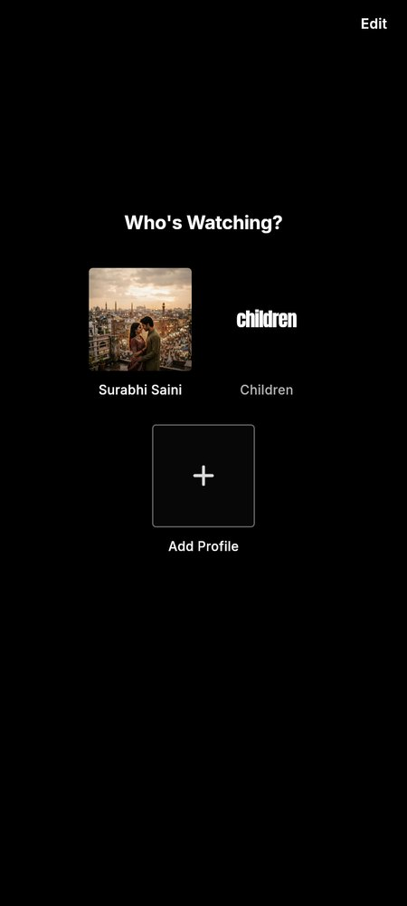
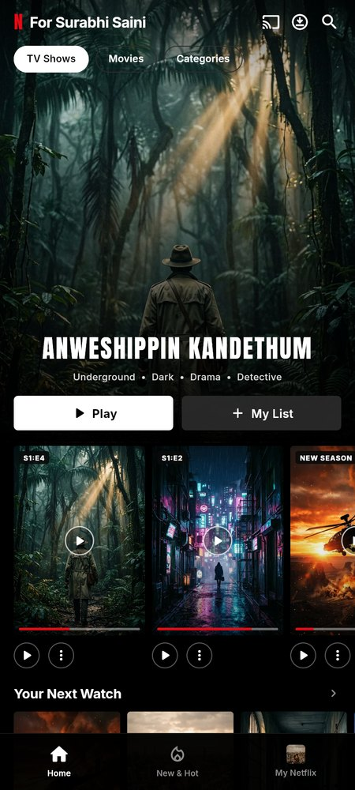
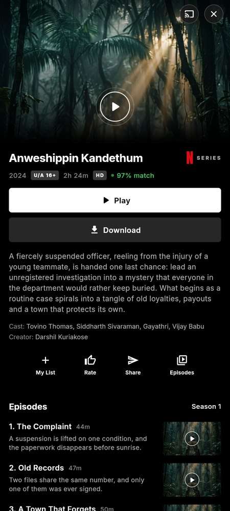
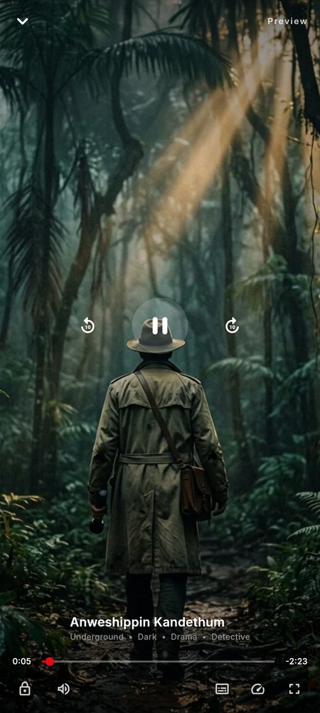

# Streamly — Netflix-style streaming app (Flutter)

[](https://flutter.dev)
[](https://dart.dev)
[](#tests)
[](#license)

A Netflix UI clone built from a five-screen design (Splash → Logo swap → Who's Watching? → Home → Details), extended with a working player, search, New & Hot and profile screens. Fully animated, fully offline, no third-party packages.

**Try it in the browser:** [GitHub Pages](https://skky15.github.io/netflix_clone/) (enable Pages → branch `main`, folder `/docs`).

<p align="center">
  
  
  
  
  
</p>

| Design frame | Where it lives |
| --- | --- |
| Splash (wordmark, then the letter-swap) | `lib/screens/splash_screen.dart`, `lib/widgets/netflix_logo.dart` |
| Who's Watching? | `lib/screens/profiles_screen.dart` |
| Home (hero, pills, rows) | `lib/screens/home_screen.dart`, `lib/screens/title_row.dart` |
| Details (preview player, buttons, episodes, More Like This) | `lib/screens/details_screen.dart` |
| Extras | `player_screen.dart`, `search_screen.dart`, `new_hot_screen.dart`, `my_netflix_screen.dart` |

## Run it

```bash
cd netflix_app
flutter pub get
flutter run -d chrome        # or any Android / iOS device
```

If Flutter is not installed on this machine, `tool/setup_flutter.sh` fetches SDK 3.24.5 into `~/.cache` and enables web.

A prebuilt web release is committed in `docs/` so it can be hosted as-is:

```bash
cd docs && python3 -m http.server 8080   # then open http://localhost:8080
```

### Hosting

* **GitHub Pages** — Settings → Pages → Source: *Deploy from a branch* → `main` / `/docs`. No build step needed.
* **Netlify / Vercel / Cloudflare Pages** — publish directory `docs`, no build command.

Building it yourself:

```bash
flutter build web --release --no-web-resources-cdn
cp -r build/web/. docs/
```

## The splash animation

The splash is not a static PNG:

1. The wordmark is real text in the Anton typeface, clipped by a custom `CustomClipper` (`LogoBlockClipper`). It reveals in 14 staggered horizontal bands so it reads as the Netflix block-wipe, not a fade.
2. A radial red glow builds underneath while the wipe plays.
3. `_swap` restarts a repeating staircase of `NETFLIX → NETF → NETFL → NET → N`, the same rhythm as the second reference frame.
4. On exit the logo scales up 14% and fades, `AppImages.preload()` has already warmed all ten posters in the image cache, and the profiles screen cross-fades in.

Total splash time is 3.05 s; the posters start preloading at 380 ms so the Home screen renders with zero image pop-in.

## Animation inventory

* Splash block-wipe logo, glow build-up, logo swap, scale-and-fade exit.
* Profiles: staggered spring entry per tile, breathing kids avatar, press-scale feedback, loading overlay on the tapped profile, scale + fade page transition.
* Home: parallax hero art (scroll-linked), top bar that darkens with scroll, animated white category pill, staggered row entrances, scrollable "Continue Watching" cards with animated progress bars, `Hero` shared element into Details.
* Details: hero preview player with a pulsing play ring, action rail, staggered episode list, staggered "More Like This" grid, collapsed title bar that cross-fades in as you scroll.
* Player: Ken Burns drift on the artwork, auto-hiding controls after 3.2 s, scrub bar, ±10 s seek, buffering state, idle badge that shows when the controls are hidden.
* Toasts, press-scale on every tappable surface, shimmer placeholders.

## Performance notes

* Ten AI-generated posters, resized and encoded to WebP: **520 KB total** (was 2.4 MB of JPEG).
* Fonts (Anton + Inter 400–800) are bundled locally — no `google_fonts`, no network at runtime.
* No third-party state or animation packages: `ChangeNotifier` + `InheritedNotifier` + explicit `AnimationController`s.
* Release web build: ~2.1 MB JS, fonts 372 KB, icons tree-shaken by the compiler.
* Scroll listeners only rebuild when the offset actually changes, offscreen rows are lazy, and every image uses `gapelessPlayback` + a short fade-in.

## Structure

```
lib/
  app/app_state.dart        profiles, category, My List, progress (ChangeNotifier)
  data/catalog.dart         all titles, rows per category, helpers
  data/models.dart          TitleItem, Profile, RowData
  theme/app_theme.dart      colours, type scale, motion tokens, dimensions
  screens/                  splash, profiles, shell, home, details, player, search, new & hot, my netflix
  widgets/                  logo, poster cards, UI kit, motion helpers, toasts, images
assets/
  posters/*.webp            generated artwork
  fonts/*.ttf               Anton + Inter
test/widget_test.dart       splash → profiles, home rows, details, catalog, state tests
docs/                       prebuilt web release (GitHub Pages ready)
screenshots/                captured from the release build
tool/setup_flutter.sh       fetches Flutter 3.24.5 into ~/.cache (Linux/macOS sandbox)
```

## Tests

```bash
flutter test
```

Six tests cover the splash-to-profiles transition, the home header and rows, opening details from the hero, category switching, the My List toggle and catalog integrity. `flutter analyze` is clean.

## Roadmap / known limits

* The player paints a Ken-Burns still instead of real video — swap in `video_player` with an HLS sample to make playback real.
* Poster art is AI-generated; one title reuses the sci-fi artwork (generation cap hit at 10 images).
* State is in-memory: My List and progress reset on app restart. Persisting them needs `shared_preferences` (one dependency).

## License

MIT — do whatever you like with it.

## Compatibility

Verified on **Flutter 3.24.5** and **Flutter 3.47.9** (current stable): `dart analyze` reports no issues and all 6 tests pass on both. The theme deliberately avoids `CupertinoPageTransitionsBuilder` (moved to `package:flutter/cupertino.dart` in newer SDKs) and uses `withAlpha` instead of `withOpacity`/`withValues`, so the same source compiles on both.

On web, Flutter's default transition is used. On iOS the native Cupertino slide is applied automatically by the framework.
